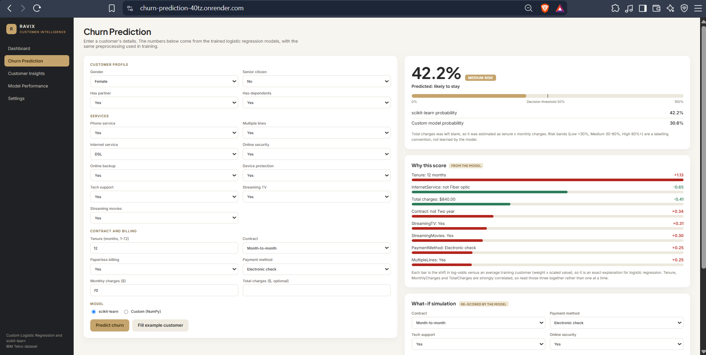
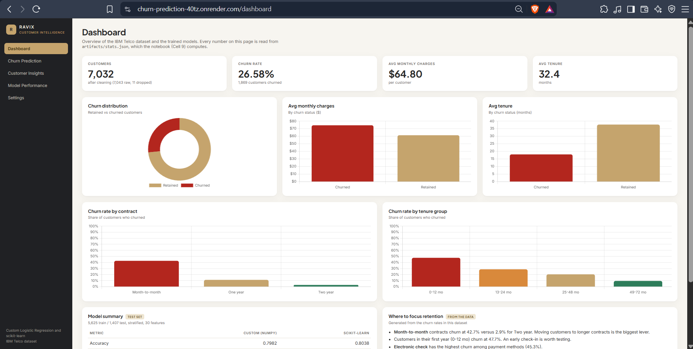
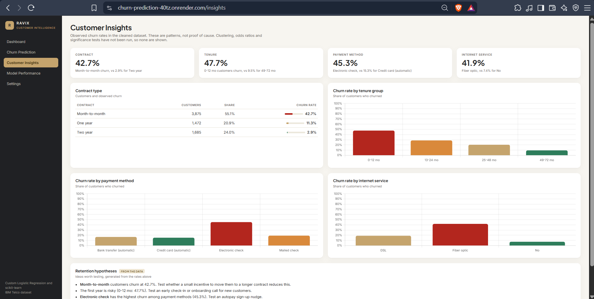
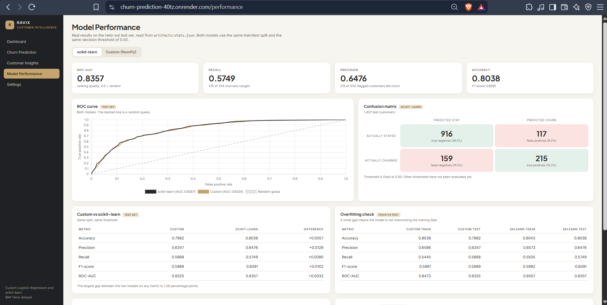
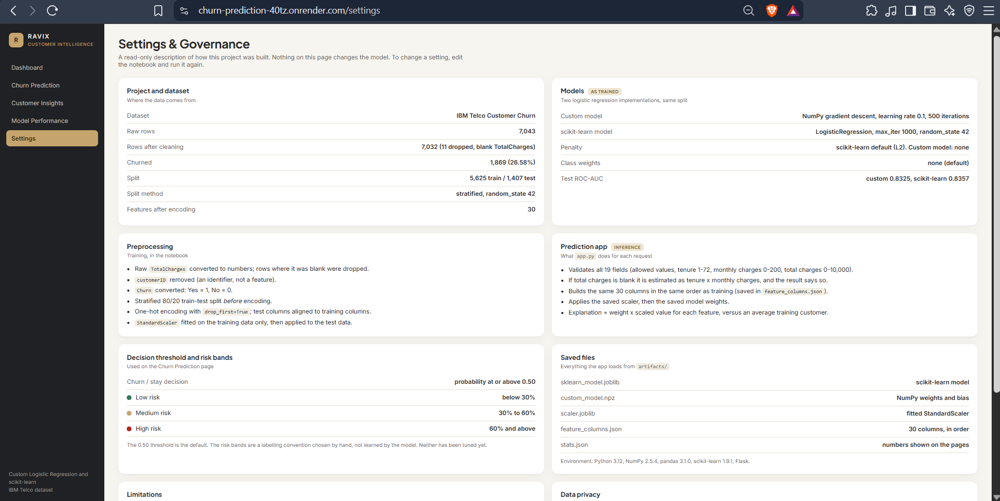

# Customer Churn Prediction

An end-to-end machine learning web app that predicts whether a telecom customer is likely to leave. It includes a logistic regression built **from scratch in NumPy**, benchmarked against scikit-learn's, and served through a Flask API with a five-page dashboard.

**Live demo:** https://churn-prediction-40tz.onrender.com

> The app runs on a free hosting plan and sleeps when idle, so the first load can take 30-60 seconds.

---

## Screenshots

| Churn Prediction | Dashboard |
|---|---|
|  |  |

| Customer Insights | Model Performance |
|---|---|
|  |  |

| Settings |
|---|
|  |

---

## Features

- **Churn prediction form:** enter 19 customer fields and get a churn probability, a predicted class, and a risk band (Low / Medium / High).
- **Two models side by side:** custom NumPy logistic regression and scikit-learn logistic regression, both scored on every prediction.
- **Explanation:** each feature's contribution (weight x scaled value, in log-odds) compared with an average training customer. This is exact for logistic regression.
- **What-if simulation:** change contract, payment method, tech support or online security and the model re-scores the customer.
- **Input validation:** invalid values return a clear error instead of a wrong prediction.
- **Dashboard, Insights, Model Performance and Settings pages**, all filled from numbers computed in the notebook.

## Dataset

[IBM Telco Customer Churn](https://www.kaggle.com/datasets/blastchar/telco-customer-churn): 7,043 customers, 21 columns.

- 11 rows were dropped because `TotalCharges` was blank, leaving **7,032** customers.
- **1,869** customers churned (**26.58%**).
- `customerID` is removed before training.

## Methodology

1. Convert `TotalCharges` to numeric, drop blank rows, encode `Churn` as 1/0.
2. Stratified 80/20 train-test split (5,625 train / 1,407 test, `random_state=42`) **before** encoding.
3. One-hot encode with `drop_first=True`; align test columns to the training columns (30 features).
4. `StandardScaler` fitted on training data only.
5. Train two models on the same split:
   - **Custom:** NumPy gradient descent, learning rate 0.1, 500 iterations.
   - **scikit-learn:** `LogisticRegression(max_iter=1000, random_state=42)`.
6. Save the models, scaler and column order to `artifacts/` so the app uses identical preprocessing at prediction time.

## Results (test set, threshold 0.50)

| Metric | Custom (NumPy) | scikit-learn |
|---|---|---|
| Accuracy | 0.7982 | 0.8038 |
| Precision | 0.6347 | 0.6476 |
| Recall | 0.5668 | 0.5749 |
| F1-score | 0.5989 | 0.6091 |
| ROC-AUC | 0.8325 | 0.8357 |

Confusion matrices (1,407 test customers):

| | TN | FP | FN | TP |
|---|---|---|---|---|
| Custom | 911 | 122 | 162 | 212 |
| scikit-learn | 916 | 117 | 159 | 215 |

Train and test scores are close (for example scikit-learn accuracy 0.8043 train vs 0.8038 test), so there is no sign of overfitting. The custom model is within about 1.3 percentage points of scikit-learn on every metric.

### Patterns in the data (observed churn rates)

- Contract: month-to-month 42.7%, one year 11.3%, two year 2.9%.
- Tenure: 0-12 months 47.7%, 49-72 months 9.5%.
- Payment method: electronic check 45.3%, credit card (automatic) 15.3%.

These are correlations, not proof of cause.

## Limitations

- Recall is about 0.57, so roughly 4 in 10 churners are missed at the 0.50 threshold. Threshold tuning has not been done yet.
- A single train-test split was used. There is no cross-validation, so the metrics have no error bars.
- Probability calibration has not been checked.
- Fairness across customer groups has not been evaluated.
- Tenure, monthly charges and total charges are strongly correlated, so individual factor bars should be read together.
- The risk bands (Low below 30%, Medium 30-60%, High 60% and above) are a hand-chosen labelling convention, not learned by the model.
- Trained on one public dataset. It may not transfer to another company or period.
- The app has no login. This is a student project, not a production system. Do not enter real customer data.

## Tech stack

Python 3.12, NumPy, pandas, scikit-learn, Flask, gunicorn, Chart.js, HTML/CSS/JavaScript. Hosted on Render. UI designed with Google Stitch.

## Project structure

```
.
├── app.py                  # Flask app: validation, preprocessing, prediction API, page routes
├── Churn_project.ipynb     # Data cleaning, both models, evaluation, saves artifacts/
├── requirements.txt
├── WA_Fn-UseC_-Telco-Customer-Churn.csv
├── artifacts/
│   ├── sklearn_model.joblib
│   ├── custom_model.npz
│   ├── scaler.joblib
│   ├── feature_columns.json
│   └── stats.json          # numbers shown on the dashboard pages
└── static/                 # index, dashboard, insights, performance, settings (HTML)
```

## Run locally

```bash
git clone https://github.com/tyagirajat154/churn-prediction.git
cd churn-prediction
python -m venv venv
venv\Scripts\activate          # Windows
pip install -r requirements.txt
python app.py
```

Open http://127.0.0.1:5000

Use Python 3.12. The saved models were created with the package versions in `requirements.txt`, so other versions may fail to load them.

To retrain, run `Churn_project.ipynb` from top to bottom. It regenerates everything in `artifacts/`.

## API

`POST /api/predict` with a JSON body of the 19 customer fields (and an optional `"model": "sklearn"` or `"custom"`). It returns the churn probability, predicted class, risk band, both models' probabilities and the top contributing factors. `GET /api/health` returns the service status.

## Future work

- Tune the decision threshold to improve recall.
- Cross-validation and a calibration check.
- Try other algorithms and compare them fairly.
- Add authentication before any use with real data.

## Author

**Rajat Tyagi**, B.Tech CSE (AI & ML), IILM University, Greater Noida
[GitHub](https://github.com/tyagirajat154)
